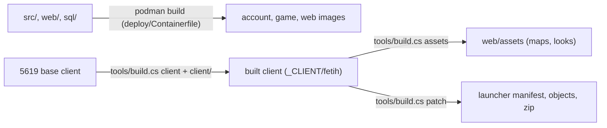

# Overview

fetih is a Conquer Online server for the 5619 client:

- **Servers** (`src/`): `Fetih.Account` (login and realm list, `:9960`), `Fetih.Game` (game world, `:5816`, RPC `:5817`), and `Fetih.Web` (public site and admin studio, `:5820`, talking to `Fetih.Game` over RPC). `Fetih.Network`, `Fetih.Core`, `Fetih.Shared`, and `Fetih.Patch` are shared libraries; `Fetih.Bots` and `Fetih.TestClient` are bots and the headless test client.
- **Database** (`sql/`): MariaDB with `fetih_account` and `fetih_game` (or `fetih_game_test` in the test environment). Servers apply `sql/fetih_*.sql` and `sql/migrations/` automatically on startup.
- **Logs and metrics** (`observability/`): servers write JSONL logs and expose Prometheus metrics (`:9818` game, `:9819` account). Alloy tails logs to Loki, Prometheus scrapes metrics, and Grafana (`:3000`) serves dashboards and alerts.
- **Client build** (`tools/build.cs`, `client/`): transforms the base 5619 client into the playable fetih client, renders map/look assets for the web, and publishes launcher patch manifests.

## Layout

| Folder | Contents |
|---|---|
| `src/` | .NET 11 servers, libraries, bots (`Fetih.Bots`), and test client (`Fetih.TestClient`) |
| `tests/` | .NET unit and integration test projects |
| `web/` | React + Vite frontend served by `Fetih.Web` |
| `client/` | Client build inputs (`delete.txt`, `files/`, `patches.json`, `servers.json`, `flash/`, `rsa.pem`) |
| `tools/` | `build.cs` and asset/client/patch build helpers |
| `sql/` | Baseline schemas (`fetih_account.sql`, `fetih_game.sql`) and `migrations/` |
| `deploy/` | `Containerfile`, `compose.yaml`, `compose.env.yaml`, `Caddyfile`, and env examples |
| `observability/` | Loki, Alloy, Prometheus, and Grafana configs, dashboards, and alert rules |
| `docs/` | Architecture, deployment, UI style, and client notes |

## Pipeline



## Commands

```bash
podman compose -f deploy/compose.yaml up -d db              # start MariaDB (required for integration tests)
podman compose -f deploy/compose.yaml up -d                 # start db, Loki, Alloy, Prometheus, Grafana
dotnet test Fetih.slnx                                      # run all .NET unit and integration tests
cd src/Fetih.Game && dotnet run                             # run game server (likewise Fetih.Account, Fetih.Web)
cd web && npm run dev                                       # run Vite dev server (:5173) against Fetih.Web (:5820)
dotnet run tools/build.cs all --ip <ip>                     # build client, web assets, and patch files
```
